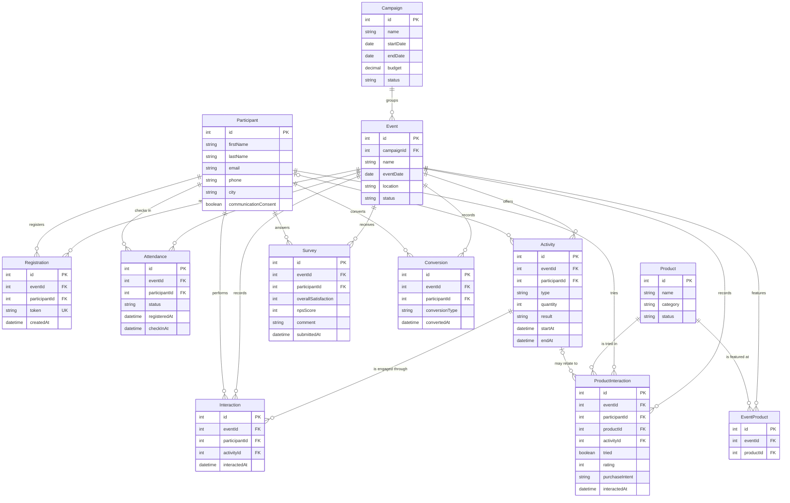

# Data Architecture & Persistence Layer

The application persists event and engagement data in PostgreSQL and maps it with JPA/Hibernate. For Power BI, connect to PostgreSQL in Import mode and build a star model from the operational tables; this keeps row-level facts available for the requested filters and measures without fabricating data.

## Database Configuration

| Service/Module | DB Type | Profile | Driver | Connection | Migration Tool |
|---|---|---|---|---|---|
| Event Intelligence backend | PostgreSQL | Default | PostgreSQL JDBC | `localhost:5432/cc_events` by default; `DB_URL` can override it | Versioned migration tool not configured; SQL schema and change scripts are applied manually |
| Power BI Desktop | PostgreSQL connector | Import recommended | Power BI PostgreSQL connector; install the Npgsql provider if prompted | Connect to the same reachable PostgreSQL host and database as the backend | Power BI refresh re-reads imported tables; it does not migrate the schema |

The backend validates the schema at startup and does not create or alter tables. Apply `schema.sql` and the required scripts under `backend/src/main/resources/db/` to the same database selected by `DB_URL` before importing it into Power BI. Keep database credentials in Power BI's credential store, not in a PBIX query or this document.

## Data Ownership per Service

| Service | Tables Owned | ORM Framework | Caching | Notes |
|---|---|---|---|---|
| Event Intelligence backend | campaigns, events, participants, registrations, attendances, activities, interactions, product_interactions, conversions, surveys, products, event_products | Spring Data JPA / Hibernate; JDBC analytics queries | No application cache or Hibernate second-level cache detected | One backend owns writes and exposes the same relational data to Power BI |
| Power BI semantic model | Imported copies of the selected PostgreSQL tables and a Calendar table | Power Query / VertiPaq | Import model cache, refreshed on demand or by a configured gateway | Read-only reporting model; do not write Power BI transformations back to production |

## Entity Model

Entity fields and relationships below follow the JPA mappings. Some SQL schema files referenced by repository documentation were not present in the workspace, so confirm the live database catalog before selecting columns in Power BI.

<!-- mermaid-checked: every attribute is `<type> <name> [<key>] ["<description>"]` with at most one of PK/FK/UK, no \n in descriptions, no {} in descriptions, every relationship label is double-quoted -->


The model is intentionally directional: dimension tables filter fact tables; do not create direct fact-to-fact relationships. In Power BI, create one-to-many, single-direction relationships from Campaign, Event, Participant, Product, and Calendar dimensions to facts. EventProduct is a bridge and can cause product/event filter ambiguity; use it only for event-product availability visuals, not to filter interaction facts unless the relationship path is explicitly controlled.

## Key Repository Methods

| Service | Repository | Notable Methods | Purpose |
|---|---|---|---|
| Event Intelligence backend | `RegistrationRepository` | `findByToken(String)`; `existsByEventIdAndParticipantId(Long, Long)` | Resolve registration token and enforce registration uniqueness |
| Event Intelligence backend | `AttendanceRepository` | `findByEventIdAndParticipantId(Long, Long)` | Resolve the event/participant attendance record |
| Event Intelligence backend | `ParticipantRepository` | `findByEmailIgnoreCase(String)` | Reuse the canonical participant during registration deduplication |
| Event Intelligence backend | `EventRepository` | Standard CRUD | Load event dimension and verify event references |
| Event Intelligence backend | `ActivityRepository`, `SurveyRepository` | Standard CRUD and service-level lookups | Persist event activity and survey data |
| Event Intelligence backend | `AnalyticsOverviewService` | Parameterized SQL aggregation over filtered events | Compute overview KPIs and peak attendance hours in PostgreSQL |

## Caching Strategy

No Redis, Caffeine, Spring Cache annotations, or Hibernate second-level cache configuration was found. Power BI Import mode stores a local VertiPaq copy in the PBIX; refresh replaces that copy from PostgreSQL. For scheduled Power BI Service refresh against a database on a developer workstation or private network, install and configure an On-premises Data Gateway on a machine that remains available. For Desktop-only use, refresh manually in Power BI Desktop.

## Data Ownership Boundaries

The backend and its tables share one PostgreSQL database; there are no separately deployed data-owning services. JPA services write operational records, while analytics uses read-only parameterized SQL and database views. Power BI should be a read-only consumer and should connect to PostgreSQL directly for dimensions and detail facts; do not combine those tables with synthetic data or duplicate aggregate API results as another fact source.

For a Power BI model, use single-direction relationships: Campaign `id` to Event `campaign_id`; Event `id` to each event-scoped fact's `event_id`; Participant `id` to each participant-scoped fact's `participant_id`; Activity `id` to Interaction and optional ProductInteraction; Product `id` to ProductInteraction and EventProduct; Calendar `Date` to Event `event_date`. Use Event `location` as the location slicer. Base the main date slicer on event date. If analysis by check-in, conversion, activity, or survey submission timestamp is required, add separate role-playing calendar dimensions or inactive relationships and measures to activate them; do not create multiple active date paths to the same fact.

### Data Classification & Sensitivity

| Entity | Sensitive Fields | Classification (PII/PHI/PCI/None) | Controls in Place |
|---|---|---|---|
| Participant | first_name, last_name, email, phone, city, consent fields | PII | No field-level masking or encryption configuration detected in the application mappings. Restrict Power BI access and exclude email, phone, token, and free-text survey comments unless needed. |
| Registration | token | Secret identifier, linked to PII | Token is unique; do not load it into the semantic model. |
| Survey | comment | Potentially sensitive free text | No masking configuration detected; omit comment from the report model or restrict it to authorized users. |
| Other listed entities | Event, campaign, attendance status/timestamps, activity, interaction, conversion, product data | Operational data; may become PII when joined to Participant | Use least-privilege database credentials and Power BI row/object-level security where required. No PHI or PCI fields were detected in the mapped entities. |

## Power BI Integration

### Source and datasets

Use **PostgreSQL directly** as the single source of truth. The direct relational source provides the detail needed for event, campaign, date, location, participant, registration, activity, conversion, survey, and hour-level filtering. The overview API is useful for application display but returns pre-aggregated values and cannot supply the complete row-level model; do not combine its totals with database facts.

In Power BI Desktop, connect to the PostgreSQL database used by the backend: default server `localhost:5432`, database `cc_events` (unless `DB_URL` overrides it). Choose **Import** mode for a local dashboard. Import these datasets:

| Dataset | Grain and important columns | Use |
|---|---|---|
| `campaigns` | One row per campaign: `id`, `name`, `start_date`, `end_date`, `status`, `budget` | Campaign dimension |
| `events` | One row per event: `id`, `campaign_id`, `name`, `event_date`, `location`, `status`, `budget`, `expected_participants` | Event dimension and date/location filters |
| `participants` | One row per canonical person: `id`, names, `city`, `age_range`, product preference, consent, source | Participant dimension; exclude PII columns not required |
| `registrations` | One row per participant/event: `id`, `event_id`, `participant_id`, `created_at` | Registration fact; do not import `token` |
| `attendances` | One row per participant/event: `event_id`, `participant_id`, `status`, `registered_at`, `check_in_at`, `check_in_method` | Attendance fact and hourly check-in |
| `activities` | One row per recorded activity: `id`, `event_id`, optional `participant_id`, `type`, `quantity`, `result`, `start_at`, `end_at`, `status` | Sampling/activities and quantities |
| `interactions` | One row per activity interaction: `event_id`, `participant_id`, `activity_id`, `interacted_at` | Engagement and event touchpoints |
| `product_interactions` | One row per product touch: `event_id`, `participant_id`, `product_id`, optional `activity_id`, `tried`, `rating`, `purchase_intent`, `interacted_at` | Product engagement |
| `surveys` | One row per respondent/event: `event_id`, `participant_id`, component scores, `overall_satisfaction`, `nps_score`, `submitted_at` | NPS and satisfaction |
| `conversions` | One row per conversion: `event_id`, `participant_id`, `conversion_type`, `converted_at` | Conversion count and type |
| `products` | One row per product: `id`, `name`, `category`, `status` | Product dimension |
| `event_products` | Event/product bridge: `event_id`, `product_id` | Product availability by event |
| `Calendar` | One row per date, generated in the model | Date filtering and trends |

Use the PostgreSQL Navigator to select tables. If schema changes are pending, first apply `registration-schema.sql`, `check-in-schema.sql`, and `activities-surveys-schema.sql` as required by the installed application version. Confirm table and column names in the live database; the source schema SQL files were not available in this workspace, but the table mappings above are present in the JPA entities.

### Relationships

Create active, one-to-many, single-direction relationships:

| One side | Many side | Join |
|---|---|---|
| `campaigns[id]` | `events[campaign_id]` | Campaign to its events |
| `events[id]` | `registrations[event_id]`, `attendances[event_id]`, `activities[event_id]`, `interactions[event_id]`, `product_interactions[event_id]`, `surveys[event_id]`, `conversions[event_id]` | Event to each event fact |
| `participants[id]` | Participant-keyed columns in registrations, attendances, interactions, product_interactions, surveys, conversions | Person to their facts |
| `activities[id]` | `interactions[activity_id]`, `product_interactions[activity_id]` | Activity to its interactions |
| `products[id]` | `product_interactions[product_id]`, `event_products[product_id]` | Product to its facts and bridge |
| `events[id]` | `event_products[event_id]` | Event to the bridge |
| `Calendar[Date]` | `events[event_date]` | Primary report date path |

Use `events[location]` for location filtering. Attendance-by-hour should use the local La Paz hour derived from `attendances[check_in_at]`; ensure timestamps are converted from PostgreSQL `timestamptz` to `America/La_Paz` before extracting hour. The date slicer above is event date; timestamp-based measures need separate date-role relationships.

### Measures (DAX)

Create these measures after loading tables. The formulas use the table and column names listed above. They assume one registration and one attendance row per participant/event, consistent with the uniqueness constraints.

Create this calculated table, then select **Marcar como tabla de fechas** and choose `Calendar[Date]`:

```DAX
Calendar =
VAR FirstDate = MINX ( ALL ( events ), events[event_date] )
VAR LastDate = MAXX ( ALL ( events ), events[event_date] )
RETURN
    ADDCOLUMNS (
        CALENDAR ( FirstDate, LastDate ),
        "Year", YEAR ( [Date] ),
        "Month Number", MONTH ( [Date] ),
        "Month", FORMAT ( [Date], "YYYY-MM" ),
        "Quarter", "T" & FORMAT ( [Date], "Q" )
    )
```

Sort `Calendar[Month]` by `Calendar[Date]`.

```DAX
Total Events =
DISTINCTCOUNT ( events[id] )

Registered Participants =
COUNTROWS ( registrations )

Attendees =
CALCULATE (
    DISTINCTCOUNT ( attendances[participant_id] ),
    attendances[status] = "CHECKED_IN"
)

Attendance Rate =
DIVIDE ( [Attendees], [Registered Participants] )

Conversions =
COUNTROWS ( conversions )

Conversion Rate =
DIVIDE ( [Conversions], [Attendees] )

Average Rating =
AVERAGE ( surveys[overall_satisfaction] )

NPS =
VAR Responses = COUNTROWS ( surveys )
VAR Promoters = CALCULATE ( COUNTROWS ( surveys ), surveys[nps_score] >= 9 )
VAR Detractors = CALCULATE ( COUNTROWS ( surveys ), surveys[nps_score] <= 6 )
RETURN
    IF ( Responses = 0, BLANK (), 100 * DIVIDE ( Promoters - Detractors, Responses ) )

Unique Registered Participants =
DISTINCTCOUNT ( registrations[participant_id] )

Engaged Attendees =
CALCULATE (
    DISTINCTCOUNT ( interactions[participant_id] ),
    TREATAS ( VALUES ( events[id] ), interactions[event_id] )
)

Engagement Rate =
DIVIDE ( [Engaged Attendees], [Attendees] )

New Participants =
VAR SelectedPeople =
    ADDCOLUMNS (
        VALUES ( registrations[participant_id] ),
        "__FirstSelectedEventDate", CALCULATE ( MIN ( events[event_date] ) )
    )
RETURN
    COUNTROWS (
        FILTER (
            SelectedPeople,
            VAR PersonId = registrations[participant_id]
            VAR FirstDate = [__FirstSelectedEventDate]
            VAR PriorRegistrations =
                CALCULATE (
                    COUNTROWS ( registrations ),
                    REMOVEFILTERS ( Calendar ),
                    REMOVEFILTERS ( events ),
                    REMOVEFILTERS ( campaigns ),
                    registrations[participant_id] = PersonId,
                    events[event_date] < FirstDate
                )
            VAR PriorAttendances =
                CALCULATE (
                    COUNTROWS ( attendances ),
                    REMOVEFILTERS ( Calendar ),
                    REMOVEFILTERS ( events ),
                    REMOVEFILTERS ( campaigns ),
                    attendances[participant_id] = PersonId,
                    attendances[status] <> "CANCELLED",
                    events[event_date] < FirstDate
                )
            RETURN PriorRegistrations + PriorAttendances = 0
        )
    )

Recurrent Participants =
VAR SelectedPeople =
    ADDCOLUMNS (
        VALUES ( registrations[participant_id] ),
        "__FirstSelectedEventDate", CALCULATE ( MIN ( events[event_date] ) )
    )
RETURN
    COUNTROWS (
        FILTER (
            SelectedPeople,
            VAR PersonId = registrations[participant_id]
            VAR FirstDate = [__FirstSelectedEventDate]
            VAR PriorRegistrations =
                CALCULATE (
                    COUNTROWS ( registrations ),
                    REMOVEFILTERS ( Calendar ),
                    REMOVEFILTERS ( events ),
                    REMOVEFILTERS ( campaigns ),
                    registrations[participant_id] = PersonId,
                    events[event_date] < FirstDate
                )
            VAR PriorAttendances =
                CALCULATE (
                    COUNTROWS ( attendances ),
                    REMOVEFILTERS ( Calendar ),
                    REMOVEFILTERS ( events ),
                    REMOVEFILTERS ( campaigns ),
                    attendances[participant_id] = PersonId,
                    attendances[status] <> "CANCELLED",
                    events[event_date] < FirstDate
                )
            RETURN PriorRegistrations + PriorAttendances > 0
        )
    )

Recurrence Rate =
DIVIDE (
    [Recurrent Participants],
    [New Participants] + [Recurrent Participants]
)
```

`Engaged Attendees` counts unique participants with an `interactions` row in the selected events. If engagement should include product-only interactions, add their unique participants to this definition and approve the business rule before publishing.

The backend currently defines NPS as promoters (9-10) minus detractors (0-6), divided by survey responses, times 100. The backend Event Impact Score is served by the per-event impact-score API operation and uses real event data. Its centralized weights are attendance 30%, engagement 20%, satisfaction 20%, conversion 20%, and recurrence 10%. The score is the weighted average of available 0-100 components, with available weights renormalized to sum to 100; no unavailable component is imputed. Use this DAX equivalent when a score is needed in the Power BI model:

```DAX
Event Impact Score =
VAR Components =
    UNION (
        ROW ( "Value", [Attendance Rate], "Weight", 0.30 ),
        ROW ( "Value", [Engagement Rate], "Weight", 0.20 ),
        ROW ( "Value", DIVIDE ( [Average Rating], 5 ), "Weight", 0.20 ),
        ROW ( "Value", [Conversion Rate], "Weight", 0.20 ),
        ROW ( "Value", [Recurrence Rate], "Weight", 0.10 )
    )
VAR AvailableComponents =
    FILTER ( Components, NOT ISBLANK ( [Value] ) )
RETURN
    IF (
        COUNTROWS ( AvailableComponents ) = 0,
        BLANK (),
        100 * DIVIDE (
            SUMX ( AvailableComponents, [Value] * [Weight] ),
            SUMX ( AvailableComponents, [Weight] )
        )
    )
```

The score API additionally returns each metric, base weight, applied weight, missing metric names, and a status (`CALCULATED`, `PARTIAL_DATA`, or `INSUFFICIENT_DATA`) so the report can disclose incomplete coverage.

### Dashboard proposal

| Page | Visuals | Slicers |
|---|---|---|
| 1 - Resumen ejecutivo | Cards: Total Events, Registered Participants, Attendees, Attendance Rate, Conversion Rate, NPS, Average Rating | Event, Campaign, Calendar date, Location |
| 2 - Asistencia | Clustered columns: registrations vs attendees by event; line/columns by event date; bar chart by La Paz check-in hour | Event, Campaign, date, Location |
| 3 - Participantes | Cards for New and Recurrent Participants; stacked bar by event; line trend by event date; Recurrence Rate | Event, Campaign, date, Location |
| 4 - Conversión | Conversion card and rate; columns by event; bar by campaign and conversion type; trend by converted date where configured | Event, Campaign, date, Location |
| 5 - Impacto | Event Impact Score card and event ranking; component bars for attendance, engagement, satisfaction, conversion, recurrence | Event, Campaign, date, Location |

### Data refresh and validation

1. Ensure PostgreSQL is running and that the backend and Power BI use the same database. The backend defaults to `cc_events`; an environment `DB_URL` overrides that target.
2. In Power BI Desktop, select **Obtener datos > Base de datos PostgreSQL**, enter the PostgreSQL host/port and database, choose **Import**, and authenticate with a read-only database account where available.
3. Select the datasets above. Remove registration tokens, unnecessary emails/phones, and survey free-text comments in Power Query before loading.
4. Create and mark `Calendar` as the model's date table. Create the relationships and DAX measures above. Use the single Calendar-to-Event date path for the event-date slicer.
5. Check row counts and totals against the source tables and the backend overview for the same event/campaign/date filters. The currently observed overview returned `registered = 0` while `attendees = 64`; this is real source state, not a Power BI fallback. Confirm registration rows are being populated before treating attendance-rate results as complete.
6. In Desktop, use **Actualizar** to reload Import data. For Power BI Service scheduled refresh against a local/private PostgreSQL server, install an On-premises Data Gateway, configure the matching PostgreSQL data source and credentials, map the semantic model to it, then configure the refresh schedule. A PBIX file is not generated by this workflow.
