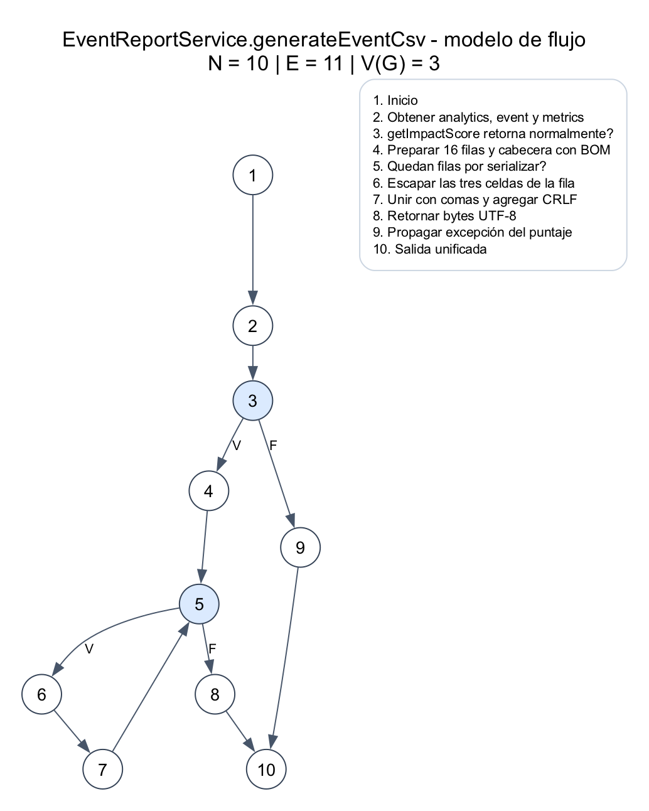
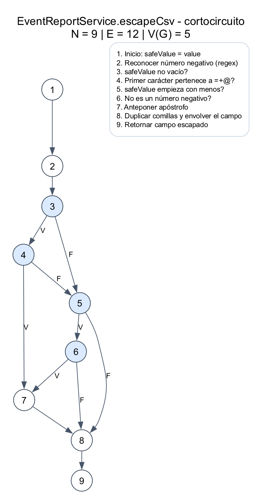

# P2-16: Reportes CSV

Implementación: 19/10/2026. Cuatro métodos `@Test` nuevos, cuatro ejecuciones;
sin parametrización. Se conservan las tres pruebas anteriores de EventReportService.

## Revisión y matriz

Las pruebas previas comprueban reporte normal, métricas ausentes y evento
inexistente. El reporte normal ya contiene una coma y acentos en etiquetas,
pero no comprueba el escape de comillas, saltos de línea, decodificación UTF-8
estricta del nombre ni propagación del error del servicio de puntaje.
Los cuatro casos aportan verificaciones distintas aunque algunos recorran las
mismas ramas. No se agregaron pruebas para inflar contadores de cobertura.

| ID | Fixture y entrada | Resultado esperado | Método |
|---|---|---|---|
| P2-16-C01 | Nombre `Encuentro "Coca-Cola"`; analytics y puntaje simulados | Registro Nombre completo con comillas internas duplicadas | `escapesDoubleQuotesInEventName` |
| P2-16-C02 | Nombre con CRLF y LF internos | Registro entre comillas conserva ambos saltos sin normalizarlos; siguiente registro Fecha comienza después del cierre | `preservesLineBreaksInsideQuotedField` |
| P2-16-C03 | Nombre `Celebración: música, café y año` | Bytes decodificables como UTF-8 estricto, BOM y texto exacto sin corrupción | `preservesAccentedCharactersInUtf8` |
| P2-16-C04 | Analytics retorna datos; getImpactScore lanza DataAccessResourceFailureException | Se propaga la misma excepción; no se devuelve byte[] parcial | `propagatesImpactScoreFailureWithoutReturningPartialReport` |

El fixture construye un Map nuevo por invocación y configura solo los mocks
que cada escenario necesita. MockitoExtension reinicializa los mocks por caso.
Las pruebas separan preparación, llamada y verificación. Son rápidas, aisladas,
repetibles y autoverificables; no usan reloj, red, PostgreSQL, Gemini ni estado
de seguridad. Se incorporaron durante el sprint: no se afirma haber aplicado
TDD antes de escribir el código de producción.

## Grafo principal

N=10, E=11, P=2: **V(G)=11-10+2=3** para este modelo conectado.
El recuadro de leyenda y el enlace invisible de maquetación no se cuentan.

El grafo abstrae el forEach de filas como bucle y muestra explícitamente el
resultado normal/excepcional de getImpactScore. Es un modelo explicativo con
una excepción seleccionada, no el CFG completo del bytecode; no incluye
excepciones de analytics, datos malformados ni el bucle interno de celdas.
Su V(G) no equivale necesariamente a la complejidad JaCoCo del método.

| Camino estructural | Prueba o factibilidad |
|---|---|
| 1-2-3-4-5-(6-7-5)x16-8-10 | C01, C02 y C03; las 16 filas se construyen siempre |
| 1-2-3-9-10 | C04: error antes de construir/serializar el reporte |
| 1-2-3-4-5-8-10 | Camino de cero filas del modelo abstracto, no factible en este método: rows siempre tiene 16 filas |

No se presenta el tercer camino como una prueba ejecutada. Las tres primeras
pruebas comparten camino principal pero verifican propiedades diferentes de
los datos. La complejidad no obliga a inventar entradas imposibles.

## Grafo de escapeCsv

N=9, E=12, P=4: **V(G)=12-9+2=5**.
Las condiciones de `&&` y `||` se separan respetando cortocircuito.
El reconocimiento de número negativo se trata como operación atómica, sin
expandir el motor regex.

| Camino base | Entrada ilustrativa | Cobertura del ticket |
|---|---|---|
| 1-2-3-4-5-8-9 | Texto ordinario | C01–C03 ejecutan este camino para el nombre del evento |
| 1-2-3-5-8-9 | Cadena vacía | No se fuerza en este ticket |
| 1-2-3-4-7-8-9 | Texto que empieza con `=` | No se fuerza en este ticket |
| 1-2-3-4-5-6-7-8-9 | Texto que empieza con menos y no es número | No se fuerza en este ticket |
| 1-2-3-4-5-6-8-9 | Número negativo, por ejemplo `-12` | No se fuerza en este ticket |

La duplicación de comillas del nodo 8 no contiene una decisión Java explícita:
C01 añade una aserción importante aunque no incremente branch coverage.
C02 conserva el contenido dentro del campo; no usa split por salto de línea
para interpretar un CSV multilinea. C03 usa un decoder estricto que falla con
bytes UTF-8 inválidos en lugar de sustituirlos silenciosamente.

## Ejecución y evidencia

Desde backend, con JDK 21: `mvn -B -ntp clean verify`.

- Suite actual: **103 aprobadas, 0 fallos, 0 errores, 0 omitidas**.
- EventReportServiceTest: **7 aprobadas** (3 anteriores + 4 nuevas).
- EventReportService: líneas **36/37 (97,30 %)**; ramas **5/10 (50 %)**.
- Backend global: líneas **656/1120 (58,57 %)**; ramas **215/480 (44,79 %)**.

La suite actual ya incorpora cambios adicionales del equipo: no atribuir a
este ticket todo el aumento desde las 75 ejecuciones de la entrega anterior.
Este ticket añade exactamente cuatro ejecuciones. No hay una medición aislada
antes/después de su cobertura y no se afirma que haya aumentado por estos casos.

Reportes históricos de esta ejecución: `docs/coverage/p2-16-2026-10-19/`.
Los grafos se regeneran con `python3 docs/testing/grafos/generate_csv_graphs.py`
(requiere Graphviz). Se incluyen fuentes DOT, PNG y SVG.

Estado: implementación y verificación automática completas; revisión de un
compañero pendiente. No se modifica producción ni se declara Terminado hasta
esa revisión. Las ramas de neutralización de fórmulas quedan como trabajo
adicional, no como cobertura lograda por este ticket.
