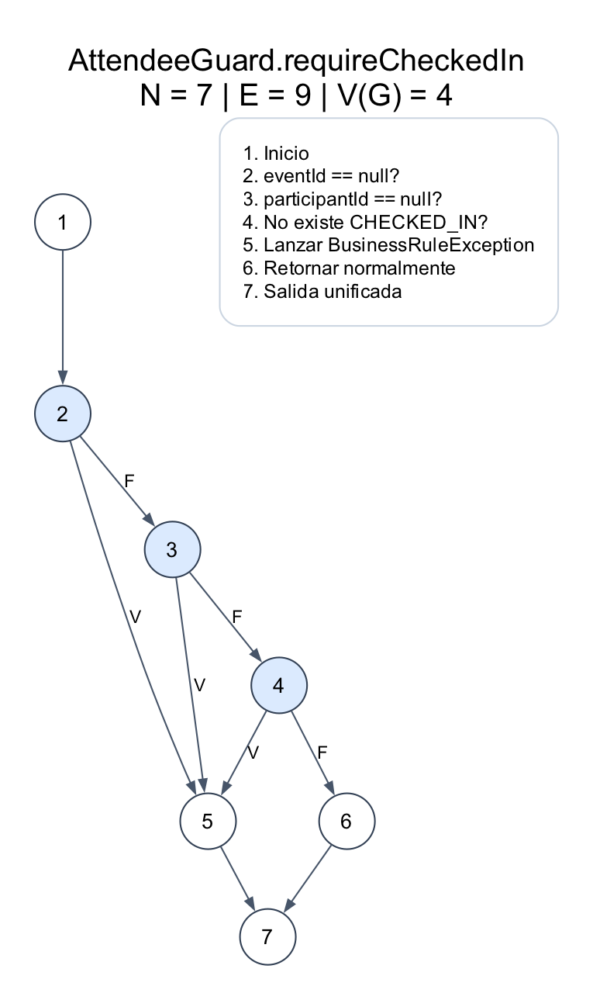
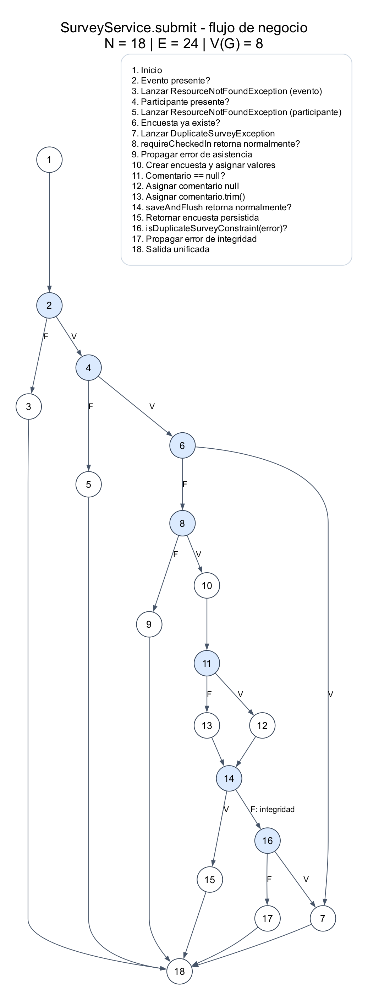
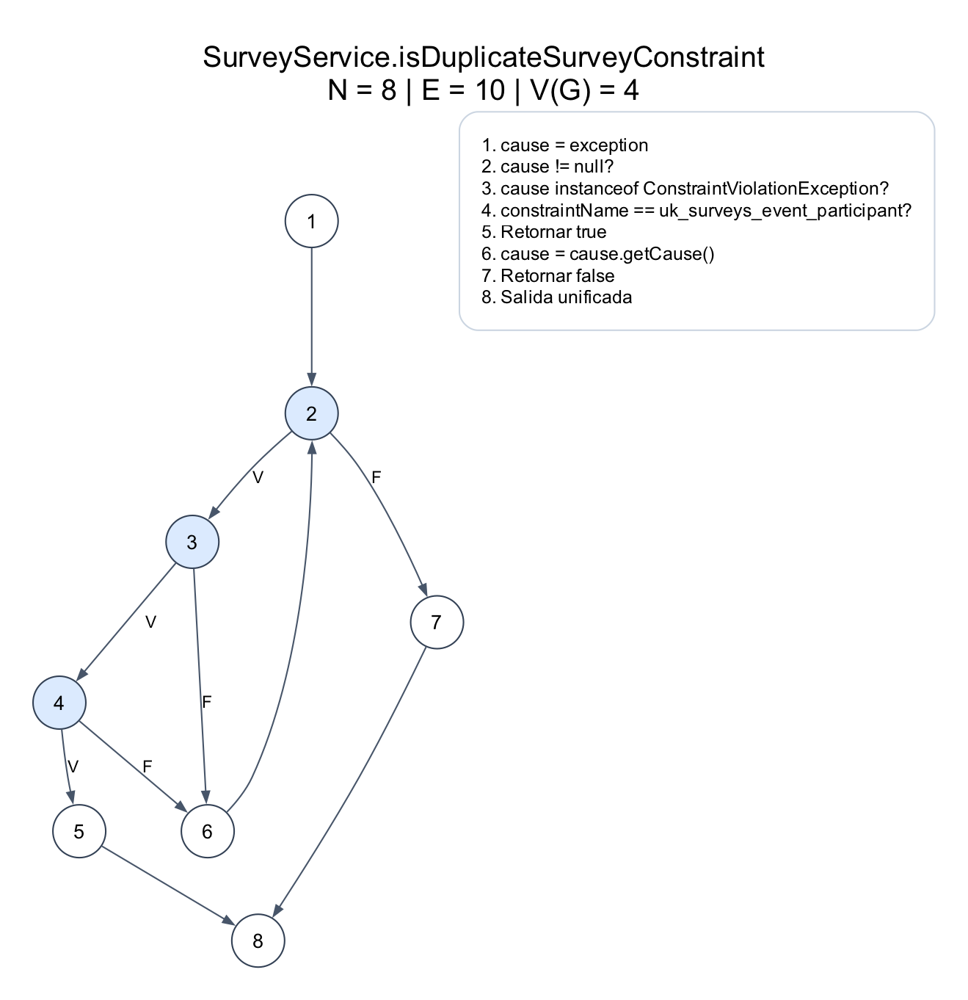

# Grafos de caja blanca: encuestas y asistencia

Material de referencia: `F White Box Testing 2025.pdf`, páginas 26–31 y 43–47.
Se emplean nodos numerados y arcos, descomposición de condiciones compuestas y
la fórmula `V(G) = E - N + 2` para cada grafo conectado con salida unificada.
Los nodos azules son decisiones; V/F significan verdadero/falso.
El recuadro de leyenda y su enlace invisible de maquetación no forman parte
del grafo ni del conteo de nodos y arcos.

## 1. AttendeeGuard.requireCheckedIn



`N = 7`, `E = 9`, `P = 3`.

**V(G) = 9 - 7 + 2 = 4 = P + 1.**

El OR del código se divide en tres decisiones respetando el cortocircuito:
si eventId es null, no se evalúa participantId ni se consulta el repositorio;
si participantId es null, tampoco se consulta el repositorio.

| Camino independiente | Entrada o condición | Prueba que lo recorre |
|---|---|---|
| 1-2-3-4-6-7 | IDs válidos y CHECKED_IN existente | `shouldAllowCheckedInParticipant` (previa) |
| 1-2-5-7 | eventId null | P2-15-C01; C03 recorre el mismo camino con ambos IDs null |
| 1-2-3-5-7 | eventId válido y participantId null | P2-15-C02 |
| 1-2-3-4-5-7 | IDs válidos y sin CHECKED_IN | `shouldRejectParticipantWithoutCheckedIn` (previa) |

Este CFG cuenta las decisiones explícitas, suponiendo que la consulta retorna
normalmente. P2-15-C04 verifica además el fallo técnico del repositorio: sale
excepcionalmente durante el nodo 4. Esa arista de excepción no se incluye en
este cálculo de V(G). No debe confundirse con el camino de ausencia de check-in.

Resultado verificado en la entrega anterior: 7/7 líneas y 6/6 ramas JaCoCo.

## 2. SurveyService.submit



`N = 18`, `E = 24`, `P = 7`.

**V(G) del modelo = 24 - 18 + 2 = 8 = P + 1.**

Este es un **modelo de flujo de negocio con excepciones seleccionadas**, no un
CFG completo de bytecode. Expande como decisiones la presencia de Optional,
el resultado de la validación de asistencia y la persistencia con error de
integridad. El auxiliar de restricciones se resume como una llamada en el nodo
16 y se desglosa en el tercer grafo. Otras excepciones técnicas posibles en
repositorios no se modelan aquí. Por esas convenciones, este V(G) no tiene por
qué coincidir con la complejidad que JaCoCo asigna al método Java.

| Camino independiente del modelo | Escenario | Prueba |
|---|---|---|
| 1-2-4-6-8-10-11-12-14-15-18 | Encuesta válida, comentario null | P2-06-C03 |
| 1-2-4-6-8-10-11-13-14-15-18 | Encuesta válida, comentario presente | P2-06-C01 y C02 |
| 1-2-3-18 | Evento inexistente | P2-06-C04 |
| 1-2-4-5-18 | Participante inexistente | P2-06-C05 |
| 1-2-4-6-7-18 | Encuesta duplicada detectada antes de guardar | P2-06-C06 |
| 1-2-4-6-8-9-18 | Falta check-in | P2-06-C07 |
| 1-2-4-6-8-10-11-12-14-16-7-18 | Restricción duplicada durante persistencia | P2-06-C08a |
| 1-2-4-6-8-10-11-12-14-16-17-18 | Otra restricción de integridad | P2-06-C08b |

Los caminos introducen aristas nuevas respecto a los anteriores. C01 y C02
comparten camino estructural, pero verifican propiedades diferentes: mapeo de
campos y limpieza del comentario. Su utilidad no se limita al número de caminos.

Resultado de la clase SurveyService: 35/37 líneas (94,59 %) y 12/12 ramas.
Esos contadores incluyen el auxiliar; el override `validate` del CRUD heredado
sigue sin ejecutar. No se afirma cobertura total de la clase.

## 3. SurveyService.isDuplicateSurveyConstraint



`N = 8`, `E = 10`, `P = 3`.

**V(G) = 10 - 8 + 2 = 4 = P + 1.**

Se separan las dos condiciones del AND: primero se comprueba el tipo de causa
y solo entonces se consulta su nombre de restricción. El arco 6-2 representa
el recorrido de la cadena de causas.

| Camino base estructural | Escenario | Estado respecto a las pruebas |
|---|---|---|
| 1-2-7-8 | Causa inicial null, cero iteraciones | No alcanzable desde submit: catch siempre proporciona una excepción no null |
| 1-2-3-4-5-8 | Primera causa es la restricción buscada | No se ejecuta exactamente así; C08a la encuentra después de recorrer envoltorios |
| 1-2-3-4-6-2-7-8 | Restricción distinta y sin más causas | C08b ejecuta este tramo después de los envoltorios |
| 1-2-3-6-2-7-8 | Causa de otro tipo sin causa posterior | C08a/b recorren el tramo de avance; una excepción genérica sin causa final sería un caso adicional |

Camino real de C08a con los mocks actuales:
`1-2-3-6-2-3-6-2-3-4-5-8`.

Camino real de C08b:
`1-2-3-6-2-3-6-2-3-4-6-2-3-6-2-7-8`.

La cadena se construye como DataIntegrityViolationException ->
IllegalStateException -> ConstraintViolationException -> SQLException.
Estos dos escenarios recorren todas las ramas del auxiliar, pero eso **no
significa recorrer todos los caminos ni todos los tamaños del bucle**. La
cadena no tiene un máximo configurado en el método; no se inventan límites
Max/Max+1 para completar una tabla. Los casos extra son oportunidades de
ampliación, no pruebas que ya se hayan implementado.

## Archivos y reproducción

Cada grafo se entrega en PNG para diapositivas, SVG para ampliar sin perder
calidad y DOT como fuente editable. `generate_graphs.py` contiene los nodos y
arcos, verifica `E-N+2 = P+1` y genera los archivos usando Graphviz:

```bash
python3 docs/testing/grafos/generate_graphs.py
```

Las imágenes y este documento explican el código; no modifican ni ejecutan la
aplicación. La complejidad determina una base estructural bajo las convenciones
del grafo, no el número total obligatorio de pruebas de negocio del proyecto.
